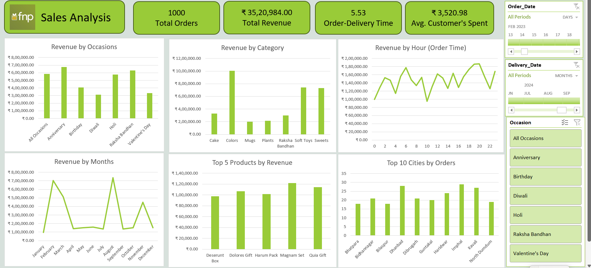

# fnp-sales-analysis-excel-dashboard

An interactive sales analysis dashboard built in Excel evaluating gift orders, revenue by occasion, category performance, customer spending, and delivery time metrics for Ferns and Petals (FNP).

# 🎁 Ferns and Petals (FNP) Sales Analysis Dashboard

## 📌 Project Overview

This project analyzes gift sales data for **Ferns and Petals (FNP)**, a major gifting brand specializing in occasions like Diwali, Raksha Bandhan, Holi, Valentine's Day, Birthdays, and Anniversaries. The objective is to uncover actionable insights regarding sales trends, customer behavior, delivery efficiency, and product performance.

---

## 📊 Dashboard Preview

---

## 🎯 Key Performance Indicators (KPIs & Metrics)

* **Total Orders:** 1,000 orders

* **Total Revenue:** ₹35,20,984.00

* **Average Order-Delivery Time:** 5.53 days

* **Average Customer Spend:** ₹3,520.98 per customer

---

## 🔍 Core Business Questions Addressed

1. **Revenue by Occasions:** Evaluates revenue generated across different festivals and milestones (*Diwali, Birthday, Anniversary, Raksha Bandhan, Holi, Valentine's Day*).

2. **Category & Product Performance:** Analyzes revenue distribution across categories (Cakes, Mugs, Plants, Sweets, Soft Toys, etc.) and tracks top-performing revenue-generating products.
3. **Monthly Sales Fluctuations:** Tracks seasonal sales trends across the months of 2023.

4. **Geographic Distribution:** Identifies the top 10 cities placing the highest volume of orders.

5. **Operational Efficiency:** Analyzes order delivery times and investigates the correlation between order quantities and shipping durations.

---

## 🛠️ Tools & Technologies Used

* **Microsoft Excel:** Pivot Tables, Advanced Slicers, Custom Timeline Filters, KPI Summary Cards, and Dynamic Charting.

* **Data Visualization & Dashboard UI:** Modern executive layout tailored for retail analytics.

* **GitHub:** Version control and portfolio management.

---

## 📂 Repository Structure

* `FNP_Sales_Dataset_1000.csv` - Transactional dataset containing order details, items, pricing, and dates.
* `Ferns and Petals Sales Analysis.pdf` - Official case study problem statement and functional requirements.

* `Dashboard Screenshot` - High-resolution visual preview of the Excel dashboard.

---
